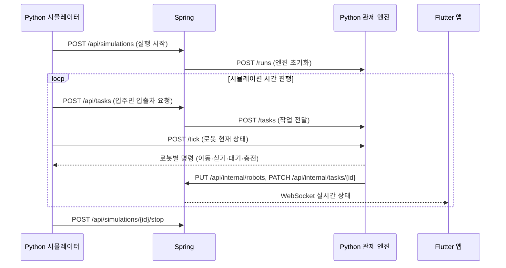

# RoboParking API 명세 (1단계 초안)

JSON 필드는 세 프로그램 모두 **camelCase**. 좌표는 `x`, `y` 따로. 시각은 시뮬레이션 시각을 ISO 문자열로 (`2026-11-26T07:31:05`). 상태값은 docs/ERD.md의 enum 이름 그대로.

## 전체 흐름



- **시뮬레이터 = 현실**: 시계를 돌리고, 입주민 요청을 만들고, 명령대로 로봇을 움직인다 (위치·배터리 계산).
- **엔진 = 두뇌**: 로봇 배정, 칸 예약, 대기·충전 판단. 결과를 Spring에 보고한다.
- **Spring = 기록·창구**: 저장하고, 앱에 보여준다. 판단하지 않는다.
- 1틱 = 로봇 1칸 이동 시간(3초, 시뮬레이션 시각). 60배속이면 실제 0.05초마다 1틱.

## Spring (localhost:8080)

### 앱·시뮬레이터용
| 메서드 | 경로 | 설명 | 호출 |
| --- | --- | --- | --- |
| GET | /api/health | 서버 상태 | 앱 |
| GET | /api/map | 격자 크기, 주차면(상태 포함), 통로, 출입구, 충전소 | 앱 |
| GET | /api/robots | 로봇 현재 상태 목록 | 앱 |
| GET | /api/vehicles | 차량 목록 (입주민 요청 화면용) | 앱 |
| POST | /api/tasks | 입차·출차 요청 | 시뮬레이터, 앱 |
| GET | /api/tasks?runId=&status=&robotId= | 작업 목록 (작업 로그 화면) | 앱 |
| POST | /api/simulations | 실행 시작 | 시뮬레이터 |
| POST | /api/simulations/{id}/stop | 실행 종료 | 시뮬레이터 |
| GET | /api/simulations | 실행 목록 | 앱 |
| GET | /api/simulations/{id}/stats | 평균 대기·소요 시간, 로봇별 가동률 (3단계) | 앱 |

### 엔진 전용 (/api/internal)
| 메서드 | 경로 | 설명 |
| --- | --- | --- |
| PATCH | /api/internal/tasks/{id} | 작업 상태·배정 로봇·결과 지표 갱신 |
| PUT | /api/internal/robots | 로봇 상태 일괄 갱신 (매 틱) |
| PATCH | /api/internal/slots/{id} | 주차면 상태 갱신 (예약·주차·비움) |

### WebSocket: ws://localhost:8080/ws
서버가 앱으로만 보낸다. `type`으로 구분.
```json
{ "type": "ROBOTS", "simTime": "2026-11-26T07:31:05",
  "robots": [ { "id": "R1", "x": 3, "y": 1, "status": "MOVING", "battery": 64 } ] }
{ "type": "TASK", "task": { "id": 12, "status": "DONE", "robotId": "R1" } }
{ "type": "SLOT", "slot": { "id": "P2", "status": "EMPTY", "vehicleId": null } }
```

## 관제 엔진 (localhost:8000)

| 메서드 | 경로 | 설명 | 호출 |
| --- | --- | --- | --- |
| GET | /health | 엔진 상태 | 누구나 |
| POST | /runs | 새 실행으로 초기화 (대기열·예약 비움) | Spring |
| POST | /tasks | 새 작업 접수 | Spring |
| POST | /tick | 로봇 상태를 받고 이번 틱 명령을 돌려줌 | 시뮬레이터 |

## 주요 요청·응답 예시

### POST /api/simulations (시뮬레이터 → Spring)
```json
요청 { "robotCount": 2, "strategy": "NEAREST", "timeScale": 60 }
응답 201 { "id": 3, "robotCount": 2, "strategy": "NEAREST", "timeScale": 60, "startedAt": "2026-11-26T13:20:00" }
```

### POST /api/tasks (시뮬레이터·앱 → Spring)
```json
요청 { "type": "EXIT", "vehicleId": 4, "requestedAt": "2026-11-26T07:31:05" }
응답 201 { "id": 12, "runId": 3, "type": "EXIT", "status": "WAITING", "vehicleId": 4, "slotId": "P2" }
실패 409 { "error": "VEHICLE_NOT_PARKED", "message": "4번 차량은 주차 중이 아닙니다" }
```
- 출차는 Spring이 차량이 있는 칸을 `slotId`로 채운다. 입차 도착 칸은 엔진이 정한다 (빈 칸 고르기도 판단이므로).

### POST /tasks (Spring → 엔진)
```json
요청 { "taskId": 12, "type": "EXIT", "vehicleId": 4, "slotId": "P2", "requestedAt": "2026-11-26T07:31:05" }
응답 202 { "accepted": true }
```

### POST /tick (시뮬레이터 → 엔진)
```json
요청 { "simTime": "2026-11-26T07:31:08",
       "robots": [ { "id": "R1", "x": 3, "y": 1, "battery": 64, "carrying": false },
                   { "id": "R2", "x": 4, "y": 1, "battery": 21, "carrying": false } ] }
응답 { "commands": [ { "robotId": "R1", "action": "MOVE", "x": 2, "y": 1 },
                     { "robotId": "R2", "action": "CHARGE" } ] }
```
- `action`: `MOVE`(다음 한 칸), `LOAD`, `UNLOAD`, `WAIT`, `CHARGE`, `IDLE`
- 다음 칸이 다른 로봇에게 예약돼 있으면 엔진은 `WAIT`을 주고 해당 작업의 대기 횟수를 1 올린다.

### PATCH /api/internal/tasks/{id} (엔진 → Spring)
```json
{ "status": "DONE", "robotId": "R1", "slotId": "P2",
  "startedAt": "2026-11-26T07:31:08", "completedAt": "2026-11-26T07:31:20",
  "moveCells": 2, "durationSec": 15, "waitCount": 0, "batteryAfter": 64 }
```
- 보낸 필드만 바꾼다. 배정 시점에는 `status: ASSIGNED`, `robotId`만 보낸다.

## 에러 응답 공통 형식
```json
{ "error": "에러코드_대문자", "message": "사람이 읽는 설명" }
```
| 상태 코드 | 쓰는 경우 |
| --- | --- |
| 400 | 필드 누락·형식 오류 |
| 404 | 없는 차량·작업·실행 |
| 409 | 상태가 맞지 않음 (주차 안 된 차 출차, 실행 중이 아닌데 요청 등) |

## 1단계에서 미루는 것
- 시뮬레이션 제어 화면(앱에서 시작·정지): 1단계는 시뮬레이터 명령어로 시작
- /api/simulations/{id}/stats: 3단계
- 인증·로그인: 하지 않음
