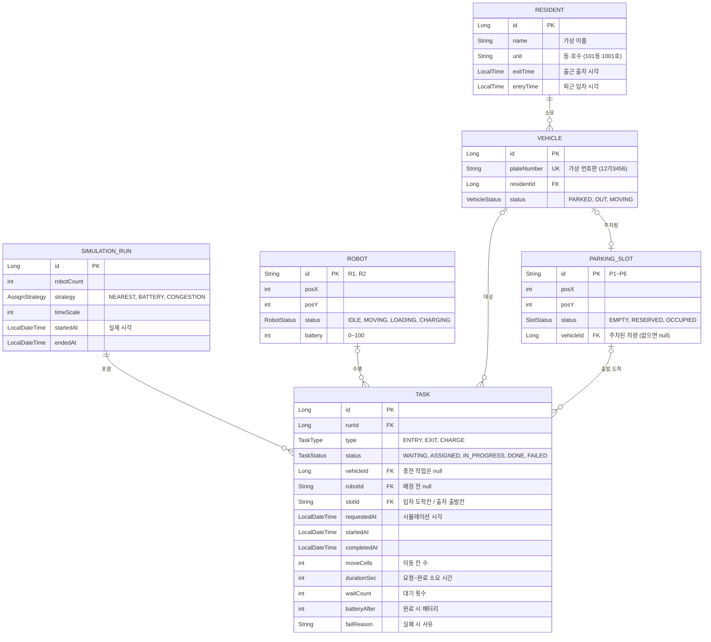

# RoboParking ERD (1단계 초안)

테이블 6개. 주차면·로봇은 `config/map.json`을 기준으로 서버 시작 시 채우고, 작업 결과는 Task에 바로 기록한다.



## 설계 결정

| 결정 | 이유 |
| --- | --- |
| TaskLog 테이블을 따로 두지 않고 Task에 결과 컬럼을 둠 | 작업 1건 = 로그 1줄이라 1:1 테이블은 중복. 작업 로그 화면은 완료된 Task 조회로 만든다 |
| ParkingSlot에 RESERVED 상태 | 입차 요청 두 건이 같은 빈 칸을 동시에 배정받지 않게 막는다 (무사고) |
| SimulationRun 테이블 | 로봇 대수·배정 방식별 결과를 실행 단위로 비교하기 위해 (고효율 검증) |
| 시각 컬럼은 시뮬레이션 시각 | 60배속이라 실제 시각과 다름. 실제 시각은 SimulationRun에만 기록 |
| 상태값은 모두 enum | 문자열 오타 방지, 상태 흐름을 코드로 강제 |
| Robot·ParkingSlot ID는 문자열 (R1, P1) | map.json·로그·화면에서 같은 이름을 그대로 쓴다 |

## 작업 상태 흐름

```
WAITING → ASSIGNED → IN_PROGRESS → DONE
                         └────────→ FAILED (배터리 부족, 칸 없음 등)
```

## 2단계 이후 추가 후보
- RobotEvent: 칸 이동·대기·충전 시작/종료를 한 줄씩 기록 (경로 재생, 대기 위치 분석용)
- 방문 차량: Vehicle에 residentId 없는 차량 허용
